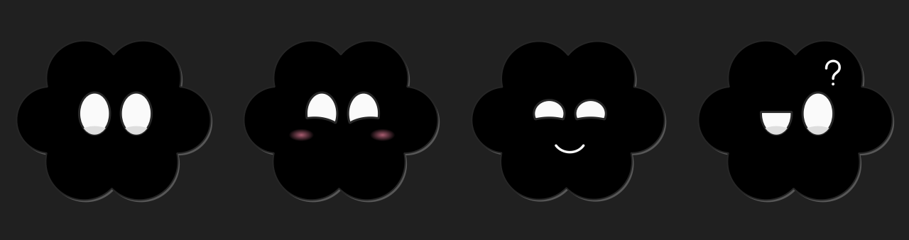

# Claus


Ditado local para Windows com um personagem animado que acompanha você na tela.

Clique em um campo de texto, diga a chamada configurada, fale e faça uma pausa. O Claus reconhece a fala no computador e insere o resultado na janela original. Não usa API de transcrição, assinatura ou tokens faturados.



## O que ele faz

- Microfone selecionável, chamada por voz configurável e conclusão automática por pausa.
- Transcrição local com Whisper na CPU ou whisper.cpp/Vulkan em GPU compatível.
- Inserção em outros aplicativos, sem pressionar Enter ou enviar mensagens.
- Personagem arrastável, com olhos que acompanham o cursor, piscadas e expressões.
- Carinho com bochechas rosas, sorriso por oito segundos e olhos em espiral após muito movimento.
- Sono aleatório, despertar sonolento, curiosidade e dança durante reprodução musical em players compatíveis.
- Tamanhos independentes, altura da onda configurável e transparência com geometria animada.
- Bandeja do Windows e atalho alternativo **Ctrl + Alt + Espaço**.
- Interface web opcional para arquivos, transcrição por trechos e exportação TXT/SRT.

## Instalar a partir do código

O instalador Windows está preparado para publicação em **Releases**, com Python, motores e modelos locais. Ele instala por usuário, cria atalhos e permite desinstalar pelo Windows. Os modelos não ficam no histórico Git; são incluídos somente no pacote de instalação. Abaixo está a alternativa para desenvolvimento a partir do código.

Requisitos: Windows 10/11 de 64 bits, Python 3.12 de 64 bits e internet na primeira instalação. Os modelos ocupam centenas de MB ou vários GB, conforme a escolha.

1. Baixe ou clone este repositório.
2. Abra o PowerShell na pasta e execute:

```powershell
.\SETUP.ps1
```

O script cria `.venv`, instala as dependências e baixa Whisper Small e o modelo Vosk em português. Para instalar o Whisper Turbo na CPU, use `./SETUP.ps1 -Model turbo`.

3. Abra `CLAUS.cmd` ou execute:

```powershell
.\.venv\Scripts\python.exe desktop.py
```

A instalação inicial usa a CPU. O download dos modelos exige internet; o aplicativo funciona offline depois de instalados. O procedimento de instalação do código está documentado, mas ainda não foi validado em um Windows limpo.

## Operar

1. **Preparar:** selecione o microfone e mantenha a ativação por voz ligada.
2. **Configurar:** escolha a chamada em português e clique em **Salvar chamada**. O padrão é `computador`.
3. **Posicionar:** clique no campo de texto do aplicativo em que deseja escrever.
4. **Ditar:** diga a chamada, aguarde a onda e fale. Uma pausa conclui a gravação.
5. **Conferir:** revise o resultado. Se o foco mudar, o texto fica na área de transferência para colagem manual.

Em **Aparência**, ajuste os tamanhos, a altura e o fundo. Arraste o personagem para movê-lo. Clique nele para abrir seu menu. Fechar a janela mantém o aplicativo na bandeja; use **Sair** para encerrá-lo.

O personagem permanece visível durante o ditado. Ele espera pelo menos um minuto após acordar antes de poder dormir novamente. A dança usa o estado publicado pelos players ao Windows, sem gravar áudio nem analisar o ritmo musical.

## GPU opcional

Instale um driver Vulkan compatível. Coloque os arquivos do runtime Windows Vulkan de [whisper.cpp/Lemonade](https://github.com/lemonade-sdk/whisper.cpp-rocm/releases/tag/v1.8.4) em `runtime/vulkan/`, incluindo `whisper-cli.exe` e as DLLs do pacote.

Baixe `ggml-large-v3-turbo-q5_0.bin` de [ggerganov/whisper.cpp](https://huggingface.co/ggerganov/whisper.cpp) para `models/ggml/`. Depois escolha o motor GPU no app. Modelos e executáveis não são distribuídos neste repositório. O desempenho depende da GPU, do driver e do áudio.

## Estrutura

| Arquivo | Responsabilidade |
| --- | --- |
| `desktop.py` | Interface, captura, ditado e bandeja |
| `desktop_engine.py` | Motores de reconhecimento locais |
| `voice_control.py` | Chamada por voz e detecção de pausa |
| `mascot.py` | Desenho, expressões e animações |
| `listening_overlay.py` | Personagem e onda de transcrição |
| `appearance.py` | Configuração visual e prévia |
| `music_monitor.py` | Leitura do estado dos players no Windows |
| `app.py` / `static/` | Interface web opcional |

## Privacidade e limites

Com a ativação por voz ligada, o microfone permanece aberto para detectar a chamada localmente. Áudio de espera não é salvo nem enviado à nuvem. O áudio do ditado é temporário; a transcrição também pode ser copiada para a área de transferência. Preferências locais ficam em `desktop-settings.ini`, ignorado pelo Git.

Ruído, conversas próximas e pausas podem causar erros. A chamada não identifica quem está falando. O ditado desktop insere texto ao concluir cada gravação; não escreve palavra por palavra enquanto você fala. Campos protegidos e aplicativos elevados podem bloquear a inserção.

Detalhes da versão instalada originalmente: [DESKTOP.md](DESKTOP.md). Referências técnicas: [PESQUISA-TRANSCRITORES.md](PESQUISA-TRANSCRITORES.md). Dependências e recursos de terceiros: [THIRD_PARTY.md](THIRD_PARTY.md).
